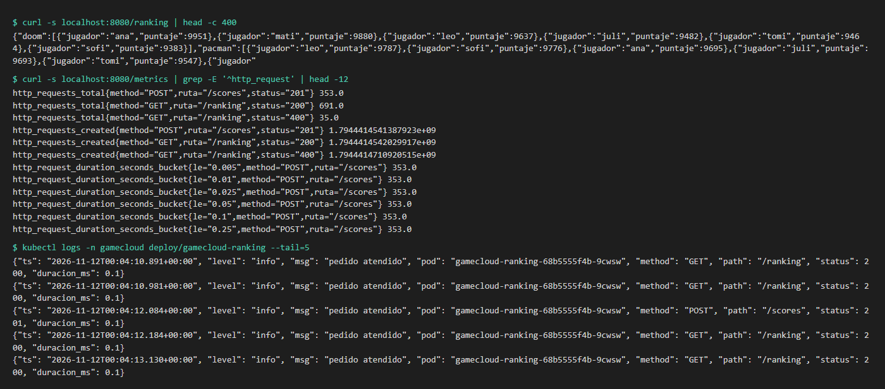
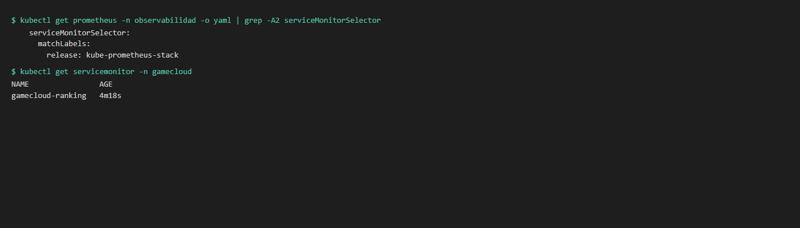
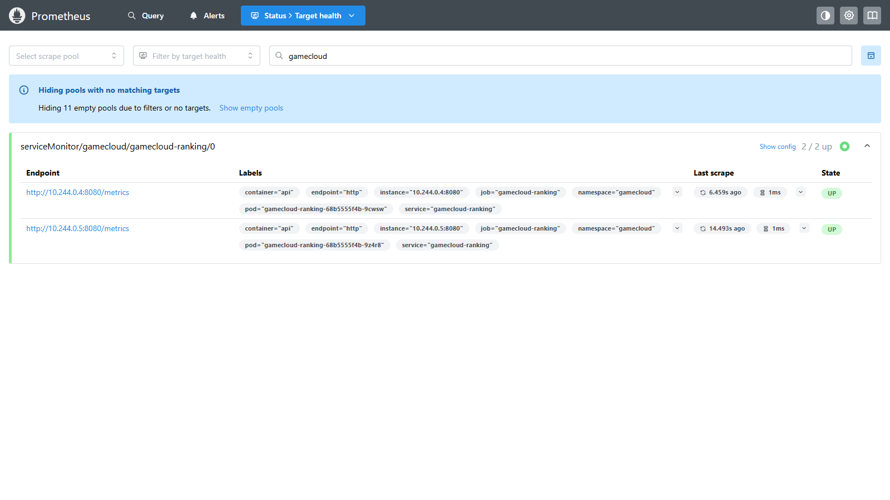
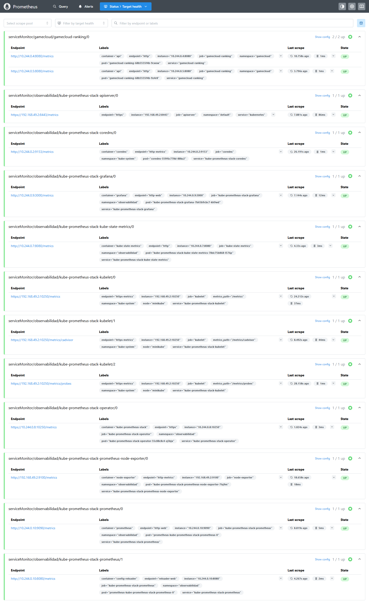
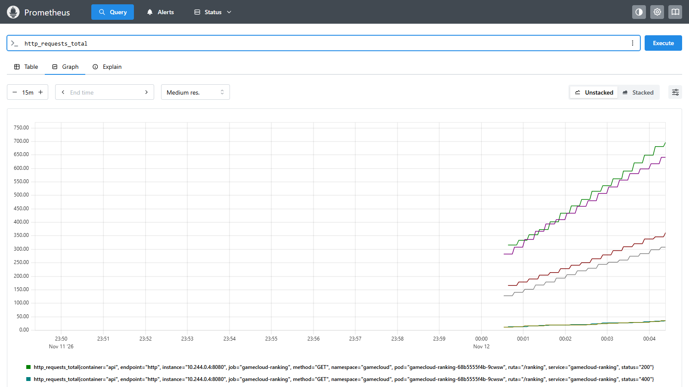
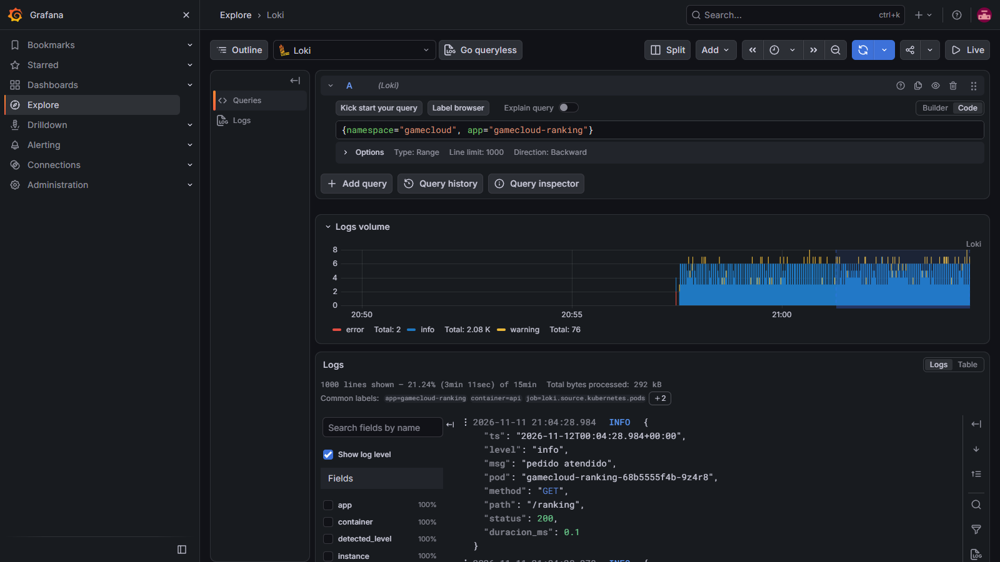
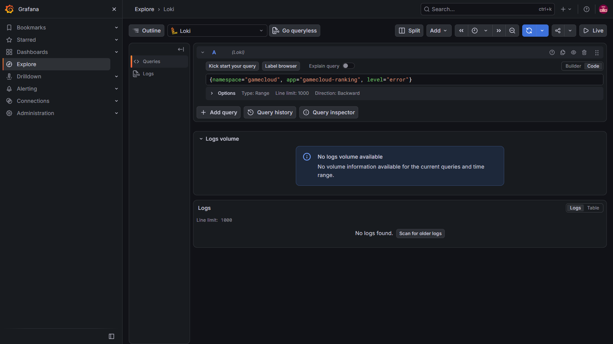
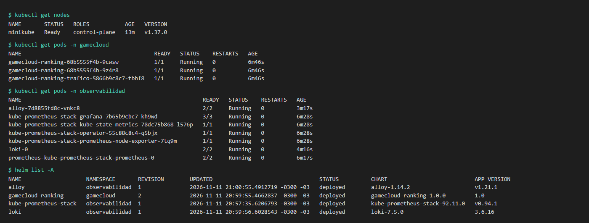
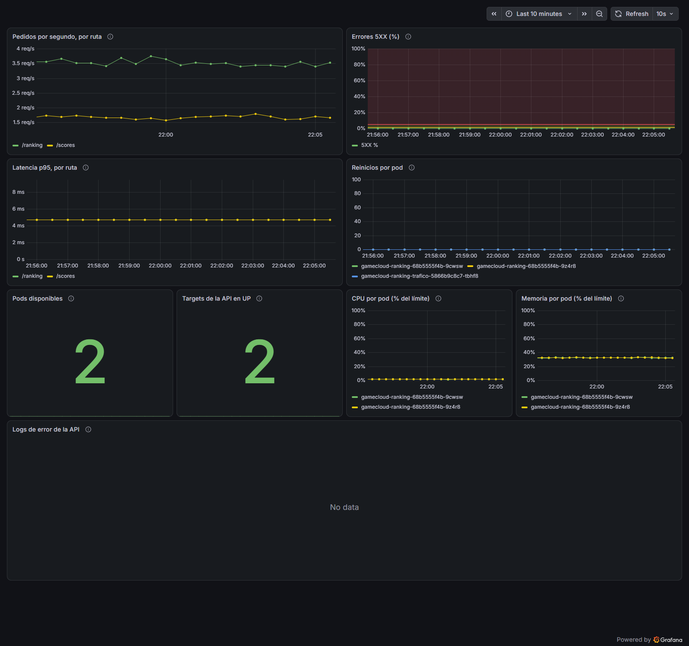

# TP4 - Observabilidad: GameCloud en Kubernetes

Stack de observabilidad sobre minikube: **Prometheus + Grafana** (kube-prometheus-stack), **Loki** y **Grafana Alloy**, observando la API de ranking de GameCloud.

```
tp4-observabilidad/
├── app/                                  API instrumentada (provista)
├── charts/gamecloud-ranking/             Chart de la API (provisto)
│   └── templates/servicemonitor.yaml     ServiceMonitor (agregado)
├── observabilidad/
│   ├── values-kube-prometheus-stack.yaml
│   ├── values-loki.yaml
│   └── values-alloy.yaml                 incluye la configuración de Alloy
├── dashboards/gamecloud-dashboard.json
└── escenarios/                           scripts de fallas (provistos)
```

Todos los comandos se ejecutan **desde la raíz del repo** en una terminal bash (en Windows: Git Bash).
Los `port-forward` quedan corriendo: abrir una terminal aparte para cada uno.

| Chart | Release | Versión |
|---|---|---|
| prometheus-community/kube-prometheus-stack | `kube-prometheus-stack` | 92.11.0 |
| grafana/loki | `loki` | 7.5.0 |
| grafana/alloy | `alloy` | 1.14.2 |

---

## 0. Preparación del entorno

Requisitos: Docker, minikube, kubectl, Helm y al menos 12 GB de RAM. En Windows:
`winget install Kubernetes.minikube Helm.Helm` y, en Docker Desktop, permitir al menos 8 GB de memoria.

```bash
minikube start --cpus 4 --memory 8192 --driver docker
kubectl get nodes                       # el nodo "minikube" debe estar Ready

helm repo add prometheus-community https://prometheus-community.github.io/helm-charts
helm repo add grafana https://grafana.github.io/helm-charts
helm repo update

kubectl create namespace observabilidad
kubectl create namespace gamecloud
```

## 1. Despliegue de la API

```bash
minikube image build -t gamecloud-ranking:1.0 app/
helm upgrade --install gamecloud-ranking charts/gamecloud-ranking -n gamecloud --wait
kubectl get pods -n gamecloud           # 2 pods de la API + 1 de tráfico, Running
```

Verificación (port-forward en otra terminal):

```bash
kubectl port-forward -n gamecloud svc/gamecloud-ranking 8080:80
curl -s localhost:8080/ranking
curl -s localhost:8080/metrics | grep -E '^http_request'
kubectl logs -n gamecloud deploy/gamecloud-ranking --tail=5   # una línea JSON por pedido
```



## 2. Prometheus y Grafana

```bash
helm upgrade --install kube-prometheus-stack prometheus-community/kube-prometheus-stack \
  --version 92.11.0 -n observabilidad \
  -f observabilidad/values-kube-prometheus-stack.yaml --wait
kubectl get pods -n observabilidad
```

Acceso (cada uno en su terminal):

```bash
kubectl port-forward -n observabilidad svc/kube-prometheus-stack-prometheus 9090:9090   # http://localhost:9090
kubectl port-forward -n observabilidad svc/kube-prometheus-stack-grafana 3000:80        # http://localhost:3000 (admin / admin)
```

**Targets down del control plane.** Si se instala sin el bloque `kubeControllerManager / kubeScheduler / kubeEtcd / kubeProxy`
del archivo de valores, `kube-controller-manager`, `kube-scheduler` y `kube-etcd` aparecen *down* en *Status → Target health* con `connection refused`
(`kube-proxy` queda UP en este clúster, porque su `metricsBindAddress` es `0.0.0.0:10249`; el archivo de valores lo deshabilita igual).
La causa es que en minikube el scheduler, el controller-manager y etcd escuchan sus métricas solo en `127.0.0.1`:

```bash
kubectl -n kube-system get pod kube-scheduler-minikube -o yaml | grep bind-address            # 127.0.0.1
kubectl -n kube-system get pod kube-controller-manager-minikube -o yaml | grep bind-address   # 127.0.0.1
kubectl -n kube-system get pod etcd-minikube -o yaml | grep listen-metrics-urls               # http://127.0.0.1:2381
kubectl -n kube-system get cm kube-proxy -o yaml | grep metricsBindAddress                     # 0.0.0.0:10249 (a diferencia de los otros tres)
```

Prometheus los intenta leer por la IP del nodo, así que nunca llega. El archivo de valores deshabilita su monitoreo.

## 3. ServiceMonitor de la API

El template `charts/gamecloud-ranking/templates/servicemonitor.yaml` se crea solo si el CRD `ServiceMonitor` ya existe
(por eso la etapa 1 funciona antes de instalar Prometheus). Lleva el label `release: kube-prometheus-stack`, que es lo que
pide el `serviceMonitorSelector` del recurso Prometheus:

```bash
kubectl get prometheus -n observabilidad -o yaml | grep -A2 serviceMonitorSelector
helm upgrade --install gamecloud-ranking charts/gamecloud-ranking -n gamecloud --wait
kubectl get servicemonitor -n gamecloud
```

En Prometheus: *Status → Target health* → `serviceMonitor/gamecloud/gamecloud-ranking/0` con 2 endpoints UP.
En *Query*: `http_requests_total`.









## 4. Logs con Loki y Alloy

```bash
helm upgrade --install loki grafana/loki --version 7.5.0 -n observabilidad \
  -f observabilidad/values-loki.yaml --wait
helm upgrade --install alloy grafana/alloy --version 1.14.2 -n observabilidad \
  -f observabilidad/values-alloy.yaml --wait
kubectl get pods -n observabilidad
kubectl logs -n observabilidad deploy/alloy --tail=20      # sin errores de envío a Loki
```

En Grafana → *Explore* → datasource **Loki** (ya creado por los valores de kube-prometheus-stack):

```logql
{namespace="gamecloud", app="gamecloud-ranking"}
{namespace="gamecloud", app="gamecloud-ranking", level="error"}
```

En estado normal la API no genera errores (solo `warning` por los 400): la consulta de `level="error"` muestra datos durante el escenario 1.





Estado final del cluster con todo desplegado:



## 5. Dashboard

Grafana → *Dashboards → New → Import* → subir `dashboards/gamecloud-dashboard.json`.
Para la entrega: *Export → Export as JSON → Download file* y reemplazar `dashboards/gamecloud-dashboard.json`.

| Panel | Consulta |
|---|---|
| Pedidos por segundo, por ruta | `sum by (ruta) (rate(http_requests_total{namespace="gamecloud"}[1m]))` |
| Errores 5XX (%) | `100 * (sum(rate(http_requests_total{namespace="gamecloud", status=~"5.."}[1m])) or vector(0)) / sum(rate(http_requests_total{namespace="gamecloud"}[1m]))` |
| Latencia p95, por ruta | `histogram_quantile(0.95, sum by (le, ruta) (rate(http_request_duration_seconds_bucket{namespace="gamecloud"}[1m])))` |
| Pods disponibles | `kube_deployment_status_replicas_available{namespace="gamecloud", deployment="gamecloud-ranking"}` |
| Reinicios por pod | `sum by (pod) (kube_pod_container_status_restarts_total{namespace="gamecloud"})` |
| CPU por pod (% del límite) | `sum by (pod) (rate(container_cpu_usage_seconds_total{namespace="gamecloud", container="api"}[1m])) / sum by (pod) (kube_pod_container_resource_limits{namespace="gamecloud", container="api", resource="cpu"})` |
| Memoria por pod (% del límite) | `sum by (pod) (container_memory_working_set_bytes{namespace="gamecloud", container="api"}) / sum by (pod) (kube_pod_container_resource_limits{namespace="gamecloud", container="api", resource="memory"})` |
| Targets de la API en UP (extra) | `sum(up{namespace="gamecloud", job="gamecloud-ranking"})` |
| Logs de error de la API | `{namespace="gamecloud", app="gamecloud-ranking", level=~"error\|critical"}` |

El panel de errores tiene umbrales visuales en 1% (amarillo) y 5% (rojo).

Dashboard en estado normal:



## 6. Escenarios de falla

Uno por vez: activar, esperar 1-2 minutos, capturar y diagnosticar, y volver a la normalidad.

```bash
bash escenarios/1_errores.sh          # 500 en el 20% de los pedidos
bash escenarios/2_latencia.sh         # +2 s por pedido
bash escenarios/3_crashloop.sh        # los pods nuevos terminan al iniciar
bash escenarios/4_puerto_service.sh   # el Service apunta al puerto 9999
bash escenarios/normal.sh             # entre escenario y escenario
```

Comandos de diagnóstico:

```bash
# 1 - errores
kubectl get deploy gamecloud-ranking -n gamecloud -o jsonpath='{.spec.template.spec.containers[0].env}'; echo
#   Loki: {app="gamecloud-ranking", level="error"}  |  sum by (pod) (count_over_time({app="gamecloud-ranking", level="error"}[1m]))

# 2 - latencia
kubectl get deploy gamecloud-ranking -n gamecloud -o jsonpath='{.spec.template.spec.containers[0].env}'; echo
#   Loki: {app="gamecloud-ranking"} | json | duracion_ms > 1000

# 3 - crashloop
kubectl get pods -n gamecloud
kubectl describe pod -n gamecloud <pod-en-CrashLoopBackOff>
kubectl logs -n gamecloud <pod-en-CrashLoopBackOff> --previous
kubectl rollout status deploy/gamecloud-ranking -n gamecloud --timeout=10s
#   Loki: {app="gamecloud-ranking", level="critical"}

# 4 - puerto del Service
kubectl get svc gamecloud-ranking -n gamecloud -o jsonpath='{.spec.ports}'; echo
kubectl get endpointslices -n gamecloud -l kubernetes.io/service-name=gamecloud-ranking
kubectl run curl-test --rm -it --restart=Never -n gamecloud --image=curlimages/curl:8.11.1 -- \
  curl -sv --max-time 3 http://gamecloud-ranking/ranking         # connection refused
kubectl get pods -n gamecloud -o wide                             # los pods siguen Running y Ready
#   Loki: sum(count_over_time({app="gamecloud-ranking"} |= "pedido atendido" [1m]))  -> cae a 0
```

Capturas de cada escenario (dashboard con ventana de 5 minutos, logs en Loki y diagnóstico):

| Escenario | Capturas |
|---|---|
| 1 - errores | [dashboard](capturas/11_esc1_dashboard.png) · [Loki](capturas/11_esc1_loki_error.png) · [diagnóstico](capturas/11_esc1_diagnostico.png) |
| 2 - latencia | [dashboard](capturas/12_esc2_dashboard.png) · [Loki](capturas/12_esc2_loki_latencia.png) · [diagnóstico](capturas/12_esc2_diagnostico.png) |
| 3 - crashloop | [dashboard](capturas/13_esc3_dashboard.png) · [Loki](capturas/13_esc3_loki_critical.png) · [pods y logs](capturas/13_esc3_pods_logs.png) · [describe](capturas/13_esc3_describe.png) |
| 4 - puerto del Service | [dashboard](capturas/14_esc4_dashboard.png) · [Loki](capturas/14_esc4_loki_pedidos.png) · [target en Prometheus](capturas/14_esc4_prom_target.png) · [Service y endpoints](capturas/14_esc4_svc_endpoints.png) · [curl y pods](capturas/14_esc4_curl_pods.png) |
| Vuelta a la normalidad | [dashboard](capturas/15_normal_final_dashboard.png) |

En el escenario 3, `describe` muestra `Last State: Terminated (Completed, Exit Code 0)` y eventos de probes fallidas seguidos de `Killing ... failed liveness probe`: el contenedor arranca pero no llega a atender `/healthz`, y el kubelet lo reinicia.

## Limpieza

```bash
minikube delete
```
